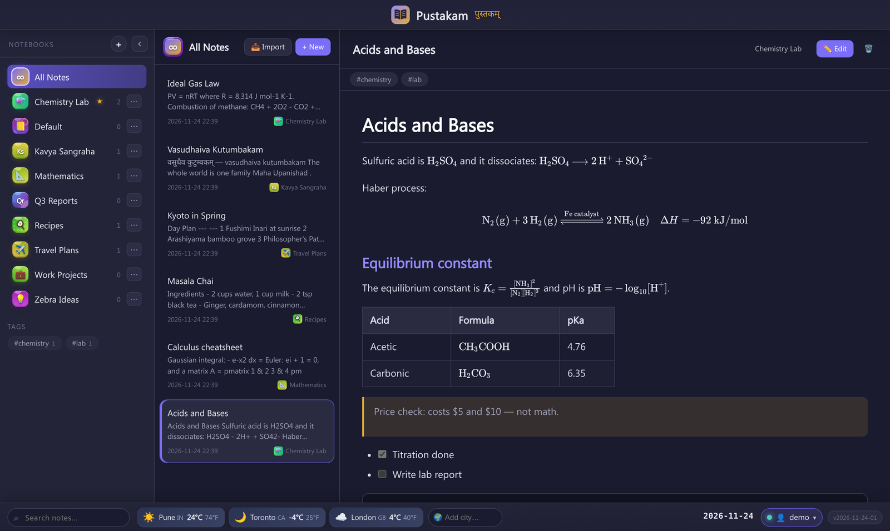
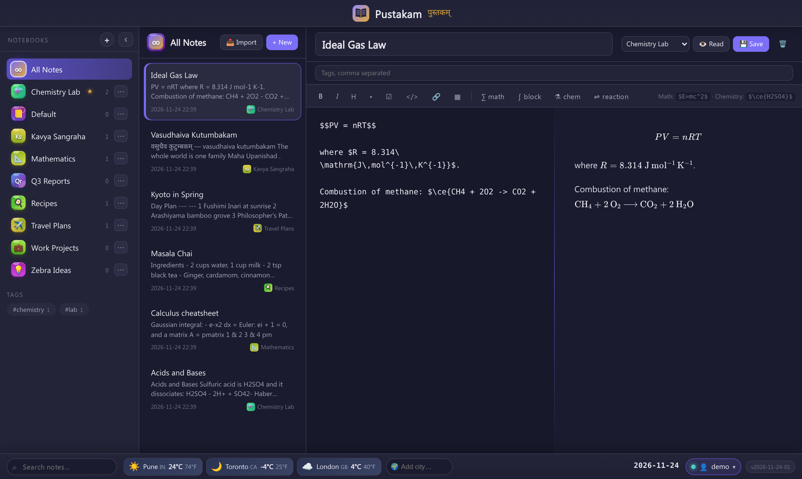
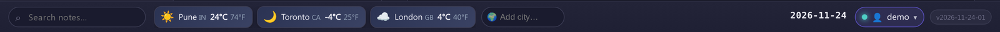
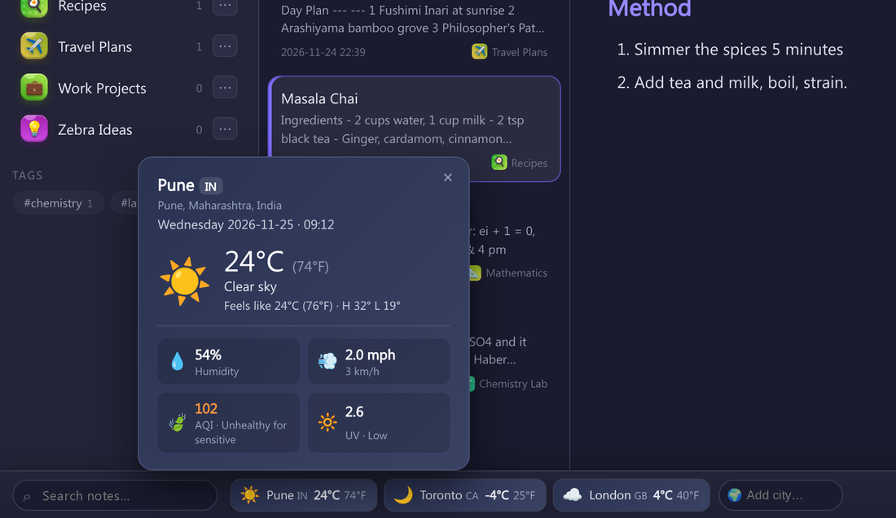
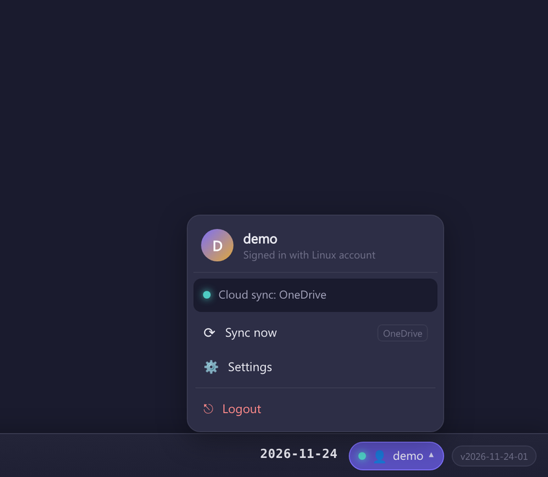
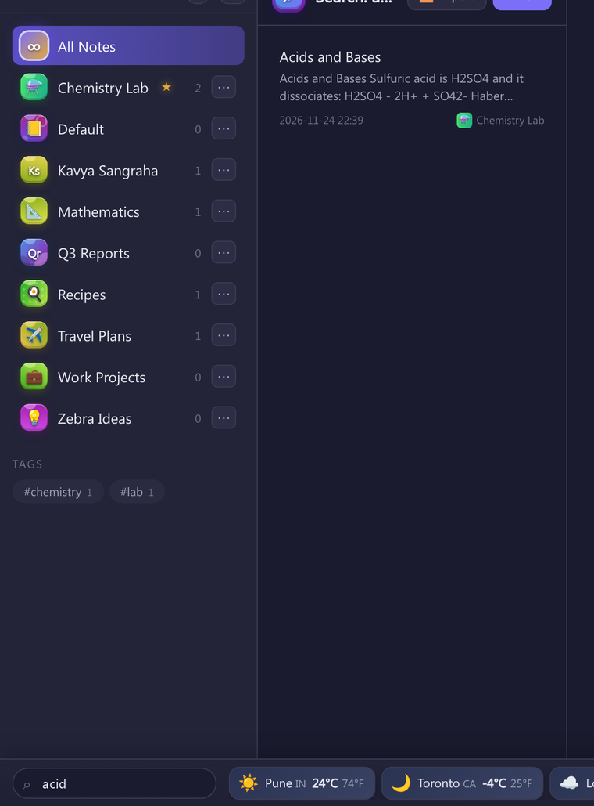
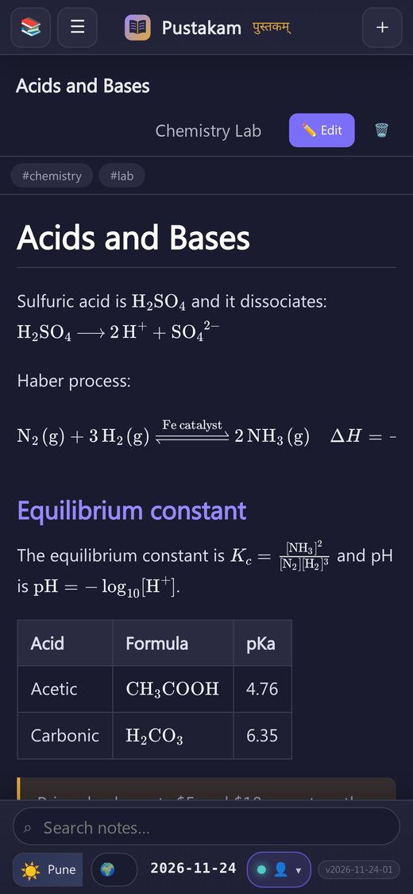

<p align="center">
  
</p>

<h1 align="center">Pustakam (पुस्तकम्)</h1>

<p align="center"><b>Your notes, your machine, your cloud.</b><br>
A local-first Markdown notebook for Linux and Windows, with two-way OneDrive sync and daily local backups.</p>

---

## 📜 The name

**पुस्तकम्** (*pustakam*, said "PUS-ta-kam") is Sanskrit for a **book**: a **manuscript**, or a **collection
of notes** and written leaves bound together. In ancient India a *pustaka* was literally a stack of palm-leaf or
birch-bark pages, strung on a cord and kept between two wooden covers: notes gathered, organised and preserved.

That is what this app is: a home for your notes, grouped into **notebooks**, written in Markdown, readable for
decades as plain `.md` files, and kept safe on your own computer, in your OneDrive, and in local backups.

## 🌟 At a glance

* **Local first.** Notes live in SQLite on your machine, plus a Markdown copy of every note. They work offline.
* **Sign in with your OS account.** Your Linux (PAM) or Windows password, so there are no extra accounts.
* **Read first, edit when you choose.** A clean reading view, and a split editor with live preview.
* **Math and chemistry.** KaTeX math (`$E=mc^2$`) and chemical formulae (`$\ce{2H2 + O2 -> 2H2O}$`).
* **Two-way OneDrive sync.** Sign in with your outlook.com / hotmail.com / msn.com account. Each notebook becomes a folder and each note a `.md` file.
* **Local backups.** Daily `.zip` backups to any folder (second disk, USB, NAS), plus **Back up now**.
* **Logs.** Sign-ins, syncs and every note change are written to plain-text logs.
* **Use it anywhere at home.** Open it from phones, tablets and other computers on your LAN, with a mobile-friendly layout.
* **Cross-platform installers.** Debian/Ubuntu/MX, Fedora/RHEL/Rocky/Alma, openSUSE and Windows 10/11.

**Version:** `2026-11-24-01` (successor of NoteVault) · **Requires:** Python 3.11+

---

## 📸 Screenshots

### Reading view
Notes open read-only, nicely typeset, with math and chemistry rendered.



### Edit mode with live preview
Press **✏️ Edit**: Markdown on the left, live preview on the right, with a toolbar for formatting, math (`∑`) and chemistry (`⚗`).



### The status bar



<table>
<tr>
<td width="50%"><b>Weather</b>: click a city for its local time, feels-like, humidity, wind, air quality and UV.<br><br>
</td>
<td width="50%"><b>Account menu</b>: who is signed in, sync status, <b>Sync now</b>, <b>Settings</b> and <b>Logout</b>.<br><br>
</td>
</tr>
<tr>
<td width="50%"><b>Search</b>: type in the bottom-left box. Matching notes from every notebook appear at once.<br><br>
</td>
<td width="50%"><b>On a phone</b>: the note gets the whole screen; 📚 and ☰ slide in the notebooks and notes.<br><br>
</td>
</tr>
</table>

*(Screenshots use sample notes and a demo account.)*

---

## ✨ Features

| | |
|---|---|
| 📚 **Notebooks** | Each notebook gets its own icon, picked from its name (*Chemistry Lab* → ⚗️, *Travel* → ✈️, otherwise its initials) on a colour and pattern unique to that name. Right-click (or **⋯**) a notebook to **set it as default**, rename or delete it. The default notebook (★) opens first and new notes go there. |
| 👁️ **Read first** | Notes open in a clean reading view. Press **✏️ Edit** (or `E`, or double-click) to edit. |
| ✂️ **Split editor** | Editing shows Markdown on the left and a live preview on the right (stacked on narrow screens), with matching scroll. |
| ∑ **Math** | KaTeX: `$E=mc^2$`, `$$\int_0^1 x^2\,dx$$`, `\( … \)`, `\[ … \]`. |
| ⚗️ **Chemistry** | mhchem: `$\ce{H2SO4}$`, `$\ce{N2 + 3H2 <=> 2NH3}$`, or a bare `\ce{CO2}` anywhere in text. Units: `\pu{9.81 m/s^2}`. |
| ☁️ **OneDrive sync** | Two-way. Sign in with your outlook.com / hotmail.com / msn.com account, no app setup. Files you add to the OneDrive folder from the web or your phone become notes here. |
| 🧭 **Status bar** | Note search, weather for your cities, today's date in ISO format (`2026-11-24`), the **account menu** (sync, settings, logout) and the version. See [Using the status bar](#-using-the-status-bar). |
| 🔐 **OS sign-in** | Linux: PAM (your Linux password). Windows: your Windows password. Logs you out after inactivity. **Logout** is in the account menu. |
| 🔎 **Search & tags** | Full-text search (SQLite FTS5) and tag filtering. |
| 💾 **Local backup** | Daily at 21:00 to any folder you choose (second disk, USB drive, NAS), plus **Back up now** in Settings. The last 5 (configurable) are kept as `.zip` files holding the database and a Markdown copy of every note. |

Keyboard: `Alt+N` new note · `E` edit · `Ctrl+S` save · `Ctrl+Enter` save and read · `Esc` back to reading.

---

## 🧭 Using the status bar

The bar along the bottom of the window holds everything that isn't part of a note, from left to right:

| Part | What it does |
|---|---|
| ⌕ **Search notes…** | Full-text search across **all** notebooks (see below). |
| 🌦️ **Weather chips** | One chip per city: icon, °C and °F, and a short description such as *Clear sky*. Click a chip for details; drag chips to reorder them. |
| 🌍 **Add city…** | Adds a city to the weather chips (see below). |
| **2026-11-24** | Today's date in ISO 8601 format (year-month-day), with the time underneath on wide screens. |
| ● 👤 **your-name ▾** | The **account button**. The dot shows sync state: 🟢 synced/OK, 🟣 pulsing = syncing, 🟡 warning, 🔴 error, ⚪ not connected. Click it for the **account menu**. |
| **v2026-11-24-01** | The Pustakam version you are running. |

**Account menu** (click your name):
* **Signed in as …**: the Linux or Windows account you signed in with.
* **Sync status**: the result of the last OneDrive sync, e.g. *Synced 21:15 — OneDrive ↑2 ↓1*. ↑ means uploaded and ↓ means downloaded.
* **⟳ Sync now**: sync with OneDrive immediately. Automatic sync also runs every 10 minutes.
* **⚙️ Settings**: OneDrive, local backup, logs, default notebook, server/LAN options.
* **⎋ Logout**: sign out. You are also logged out automatically after inactivity (15 minutes by default).

Keyboard users: focus the account button and press `Enter`, use `↑`/`↓` to move through the menu, and `Esc` to close it.

### 🔎 Searching your notes

1. Click **Search notes…** at the bottom left (on a phone, tap it and the notes list slides in).
2. Start typing. Results update as you type and include note titles **and** text from every notebook. The list header changes to *Search: …*.
3. Each word matches the start of words, so `chem` finds *chemistry* and *chemical*. Several words must **all** appear: `acid table` finds notes containing both.
4. Click a result to open it. To leave search, clear the box (the ✕ in the box, in most browsers) or click any notebook.

Tip: click a **#tag** under *Tags* (or on an open note) to list every note with that tag.

### 🌍 Adding weather for a city

1. Click **🌍 Add city…** in the status bar and type at least two letters of a city, e.g. `Pune` or `Toronto`.
2. Pick the right place from the suggestions; they show the region and country, so *Portland, Oregon* and *Portland, Maine* are easy to tell apart. It's added as a chip straight away.
3. **Click a chip** to see local date and time, feels-like temperature, today's high/low, humidity, wind (mph and km/h), air quality (US AQI, colour-coded) and UV index.
4. **Drag chips** to reorder them. To **remove** a city, open its chip and click **✕**.

Up to 12 cities can be shown. They are saved on the server, so they appear in every browser you sign in from.
Weather comes from [Open-Meteo](https://open-meteo.com) (free, no API key) and refreshes every 15 minutes.

---

## 📦 Install

### Linux: Debian family (Debian, Ubuntu, Mint, MX, siduction) and Red Hat family (Fedora, RHEL, Rocky, Alma)

```bash
git clone https://github.com/ggr03/Pustakam.git
cd Pustakam
./PustakamInstall.sh
```

The installer:
* finds **Python 3.11+**; if missing it installs it with apt, dnf, yum or zypper (the distro's `python3`, or the side-by-side
  `python3.11` package on Ubuntu 22.04, RHEL/Rocky/Alma 8–9 and openSUSE Leap),
* installs into `~/.local/share/pustakam` with a private Python environment,
* offers to **copy your NoteVault notes** and to stop the old NoteVault service (same port 5150),
* creates a **systemd user service** `pustakam` plus a daily backup timer, and enables lingering so it runs at boot.
  On systems without systemd user services it uses cron `@reboot` instead,
* optionally opens port 5150 in **firewalld** (Fedora/RHEL) or **ufw** (Ubuntu) for LAN access,
* adds a "Pustakam" launcher to your applications menu.

```bash
systemctl --user status pustakam        # status
systemctl --user restart pustakam       # restart
journalctl --user -u pustakam -f        # logs
```

Uninstall: `~/.local/share/pustakam/PustakamUninstall.sh` (your notes are kept unless you type `DELETE`).

### Windows 10 / 11

Download or clone the repository, then in PowerShell, from the `Pustakam` folder:

```powershell
powershell -ExecutionPolicy Bypass -File .\PustakamInstall.ps1
```

* Finds **Python 3.11+** (offers `winget install Python.Python.3.12` if missing).
* Installs into `%LOCALAPPDATA%\Pustakam`, data in `%USERPROFILE%\.pustakam`.
* Registers a hidden **Task Scheduler** task `Pustakam` that starts when you log on
  (`-RunAtStartup` starts it at boot, before log-on; Windows asks for your password once).
* Registers `Pustakam Backup` (daily 21:00) and a Start-menu shortcut.
* `-OpenFirewall` (as Administrator) allows other devices on your private network.

Uninstall: `powershell -ExecutionPolicy Bypass -File "%LOCALAPPDATA%\Pustakam\PustakamUninstall.ps1"`

### Sign in

Open **http://localhost:5150** and sign in with the operating-system account that runs Pustakam.
Other accounts are refused because the notes belong to that account. To allow more, list them in
`~/.pustakam/config.json` → `"allowed_users": ["name"]`.

* **Windows, Microsoft account:** username `MicrosoftAccount\you@outlook.com` and your account password. A Windows Hello PIN cannot be used.
* **Linux:** the PAM service is `login` (change `"pam_service"` in `config.json` if your distro needs another).

---

## ☁️ OneDrive sync setup

### Microsoft OneDrive: just sign in
No setup. In **Settings → Microsoft OneDrive**, choose the folder, then click **Sign in with Microsoft** and log in with your
**outlook.com, hotmail.com, live.com or msn.com** account (work/school accounts work too).
Pustakam uses [rclone](https://rclone.org), a widely used open-source sync tool, for OneDrive, so Microsoft's consent page names
the app **rclone**. The installer downloads the official rclone build (SHA-256 verified) into Pustakam's own folder.
The OneDrive token is stored in `~/.pustakam/rclone.conf` (chmod 600), separate from any rclone setup of your own.

After you approve access, Pustakam **tests the connection automatically**: it checks your account,
creates or opens the folder, and writes, reads and deletes a test file. Use **🧪 Test** at any time.

### 🌐 Using Pustakam from other devices on your LAN

Pustakam listens on all network interfaces (`0.0.0.0:5150`). From any device on your network, open
`http://<this computer's IP>:5150` (Settings → Server shows the exact address, e.g. `http://192.168.1.50:5150`)
and sign in with the same Linux/Windows account. If a firewall is on, the installer offers to open port 5150
(firewalld, ufw, or Windows Firewall with `-OpenFirewall`).

> **OneDrive sign-in from another device:** Microsoft sends you back to a `localhost` address, which on that
> device shows "can't be reached". Copy that page's full address and paste it into the box that appears under the
> provider in Settings; Pustakam finishes the sign-in on the server.

### How two-way sync works

```
<your folder>/                    e.g. OneDrive/Pustakam   or   OneDrive/Documents/Notes/Pustakam
├── Loose note.md                 notes without a notebook
├── Chemistry Lab/                each notebook = a sub-folder
│   ├── Acids and Bases.md        each note = a .md file (title = file name)
│   └── Shopping.txt              .md, .markdown and .txt files you add become notes
└── Travel Plans/
```

* New, edited, renamed, moved and deleted notes and notebooks sync both ways.
* If a note changed **on both sides** since the last sync, your local version is kept and the cloud
  version is saved as a separate note named `… (conflict OneDrive 2026-11-24 2015)`.
* Deleted notes go to the OneDrive recycle bin, never permanently deleted.
* **Safety stop:** if most linked notes suddenly disappear from the cloud (wrong account, folder moved),
  the sync stops instead of deleting them locally. Use **Reset link** in Settings if that was intended.
* Automatic sync runs every 10 minutes (change it in Settings, `0` = manual only), and the **⟳ Sync** button
  in the status bar syncs right away.
* Only the top level and first-level folders are synced. Deeper sub-folders are ignored.

---

## 📁 Where things are stored

Your **notes and settings** live in a `.pustakam` folder in your home folder; the **program** is installed separately,
so reinstalling or upgrading never touches your notes.

### 🐧 Linux

| What | Location |
|---|---|
| Notes database (notes, notebooks, tags, sync state) | `~/.pustakam/pustakam.db` |
| Markdown copy of every note | `~/.pustakam/notes/` |
| Settings | `~/.pustakam/config.json` (chmod 600) |
| OneDrive sign-in (rclone) | `~/.pustakam/rclone.conf` (chmod 600) |
| Local backups (default; change in Settings) | `~/.pustakam/backups/pustakam-backup-1.zip` (newest) … `-5.zip` |
| Logs | `~/.pustakam/Logs/` with `connection.log`, `sync.log`, `notes.log`, `backup.log` |
| Program | `~/.local/share/pustakam/app/` |
| Python environment | `~/.local/share/pustakam/venv/` |
| rclone (for OneDrive) | `~/.local/share/pustakam/bin/rclone` (or the system `rclone`) |
| Background service | `~/.config/systemd/user/pustakam.service` |
| Daily backup timer (21:00) | `~/.config/systemd/user/pustakam-backup.timer` (+ `.service`) |
| Apps-menu launcher | `~/.local/share/applications/pustakam.desktop` |
| Uninstaller | `~/.local/share/pustakam/PustakamUninstall.sh` |

### 🪟 Windows

| What | Location |
|---|---|
| Notes database (notes, notebooks, tags, sync state) | `%USERPROFILE%\.pustakam\pustakam.db` (e.g. `C:\Users\you\.pustakam\…`) |
| Markdown copy of every note | `%USERPROFILE%\.pustakam\notes\` |
| Settings | `%USERPROFILE%\.pustakam\config.json` |
| OneDrive sign-in (rclone) | `%USERPROFILE%\.pustakam\rclone.conf` |
| Local backups (default; change in Settings) | `%USERPROFILE%\.pustakam\backups\pustakam-backup-1.zip` (newest) … `-5.zip` |
| Logs | `%USERPROFILE%\.pustakam\Logs\` with `connection.log`, `sync.log`, `notes.log`, `backup.log`, `server.log` |
| Program | `%LOCALAPPDATA%\Pustakam\app\` (e.g. `C:\Users\you\AppData\Local\Pustakam\app\`) |
| Python environment | `%LOCALAPPDATA%\Pustakam\venv\` |
| rclone (for OneDrive) | `%LOCALAPPDATA%\Pustakam\bin\rclone.exe` (or a system `rclone`) |
| Background service | Task Scheduler task **`Pustakam`** (runs `pythonw.exe PustakamApp.py` at log-on, or at start-up with `-RunAtStartup`) |
| Daily backup (21:00) | Task Scheduler task **`Pustakam Backup`** |
| Start-menu shortcut | `%APPDATA%\Microsoft\Windows\Start Menu\Programs\Pustakam.url` |
| Firewall rule (optional) | Windows Defender Firewall rule **`Pustakam`** (TCP 5150, private networks) |
| Uninstaller | `%LOCALAPPDATA%\Pustakam\PustakamUninstall.ps1` |

### Logs and backups

* **Logs:** `connection.log` records sign-ins and OneDrive connect/tests. `sync.log` records every sync action. `notes.log`
  records every note or notebook created, edited, moved or deleted (titles only, never note text). `backup.log` records backups.
  Each is capped at 2 MB with 5 rotations, and you can read them in **Settings → 📜 Logs**.
* **Restore a backup:** stop Pustakam (`systemctl --user stop pustakam`, or `Stop-ScheduledTask Pustakam` on Windows),
  unzip `pustakam.db` from the backup into the `.pustakam` folder, then start it again.

See [`PustakamFileStructure.txt`](PustakamFileStructure.txt) for the source layout.

## 🧰 Requirements

**Python 3.11 or newer**, `flask`, `requests`, `waitress`, and `python-pam` (Linux only); see `PustakamRequirements.txt`. rclone 1.58+ for OneDrive (installed by the installers via `PustakamGetRclone.py`).
The editor loads marked, DOMPurify, KaTeX (+ mhchem) and highlight.js from the jsDelivr CDN, and weather
comes from [Open-Meteo](https://open-meteo.com) (no API key). Both need internet access. Notes work offline.

## 📄 License

Pustakam is released under the [MIT License](LICENSE): free to use, copy, modify and share, with no warranty.
It talks to [rclone](https://rclone.org) (MIT) and loads [marked](https://marked.js.org), [DOMPurify](https://github.com/cure53/DOMPurify),
[KaTeX](https://katex.org), [highlight.js](https://highlightjs.org) and [Flask](https://flask.palletsprojects.com), each under its own open-source licence.
